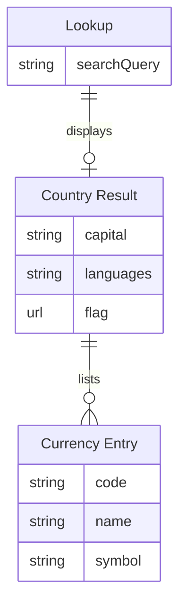

# Bouncing Countries

A country-information prototype combining a React interface with an Express service.

**React · Node.js · Express**

[Getting started](#getting-started) · [Data model](#entity-relationship-diagram) · [Repository guide](#repository-guide) · [Checks](#checks-and-review) · [Credits](#credits-and-reuse)

## What you can explore

- Country-name search and a landing page.
- Capital, population, currency, language and flag information.
- An Express country lookup route using REST Countries.

> **Project notes:** The search component currently calls REST Countries directly. The Express country route is a separate implementation; its public/index.html fallback is not a production React build.

## Entity relationship diagram

The React search calls REST Countries directly and displays the first matching country. It flattens capital and language lists for display and keeps currencies as entries keyed by currency code. The result is held in React state. [Search component](bouncing-countries-frontend/src/components/Search.js)



## Getting started

Requires Git, Node.js and npm. The frontend and backend are separate packages.

```bash
git clone https://github.com/SamOBrienOlinger/Bouncing-Countries-Frontend.git
cd Bouncing-Countries-Frontend
```

Install all three package manifests, then start the combined development command:

```bash
npm install
npm --prefix bouncing-countries-backend install
npm --prefix bouncing-countries-frontend install
npm start
```

The React development server normally uses port 3000 and Express uses port 3001. The current search component calls REST Countries directly.

## Repository guide

| Path | Purpose |
| --- | --- |
| [bouncing-countries-backend/package.json](bouncing-countries-backend/package.json) | Package dependencies and available commands |
| [bouncing-countries-frontend/package.json](bouncing-countries-frontend/package.json) | Package dependencies and available commands |
| [package.json](package.json) | Package dependencies and available commands |

## Checks and review

Use Node.js and npm for the package commands below. Install the package dependencies first when the command uses a local build or test tool.

| Command | Purpose |
| --- | --- |
| `npm --prefix bouncing-countries-frontend run build` | Create the configured application build |
| `npm --prefix bouncing-countries-frontend test -- --watchAll=false` | Run the existing test suite |

For a manual review, follow the main user journey, check keyboard navigation and narrow-screen layouts, and inspect the browser console for missing assets or failed requests.

Generate fresh results from the revision you are working on; historical test reports describe earlier runs.

## Deployment

Hosting entry points are recorded in [Procfile](Procfile). Configure the runtime, database, allowed origins and static/media handling for the chosen host. Historical deployment records may describe services that are no longer available.

## Credits and reuse

No repository-level licence file is present in this snapshot. This README does not grant additional reuse permissions. Check with the relevant rights holders before reusing code, written content or assets.

## Support

Repository maintained in [Sam O’Brien-Olinger’s GitHub account](https://github.com/SamOBrienOlinger). For a problem or suggested improvement, [open an issue](https://github.com/SamOBrienOlinger/Bouncing-Countries-Frontend/issues) with the affected page or command, steps to reproduce, and expected behaviour.

[Back to top](#bouncing-countries)
